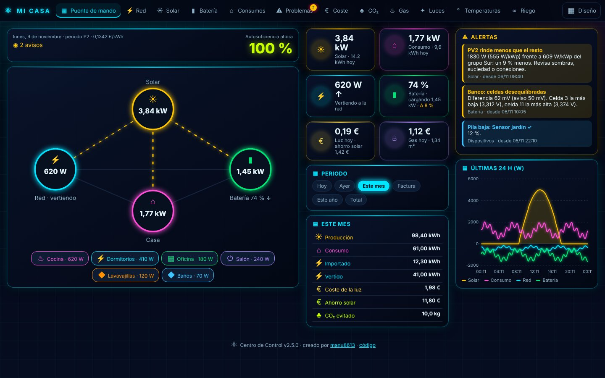
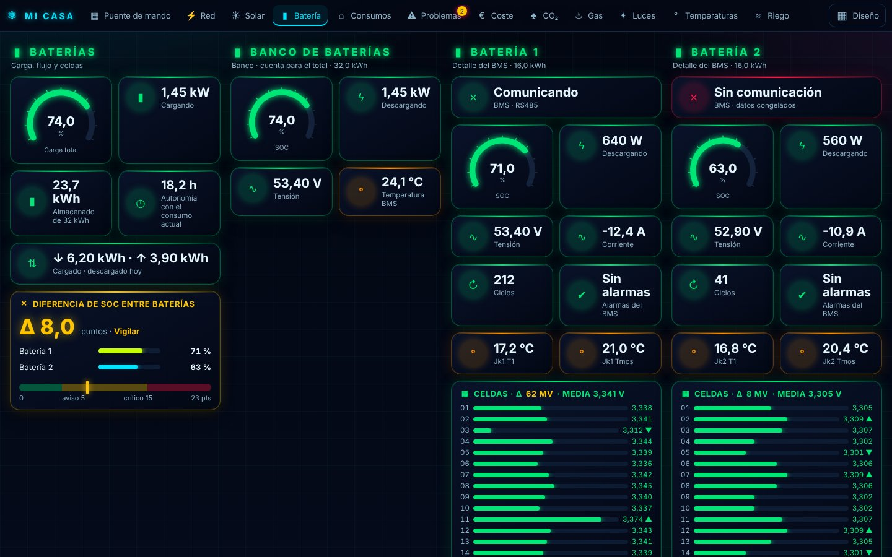
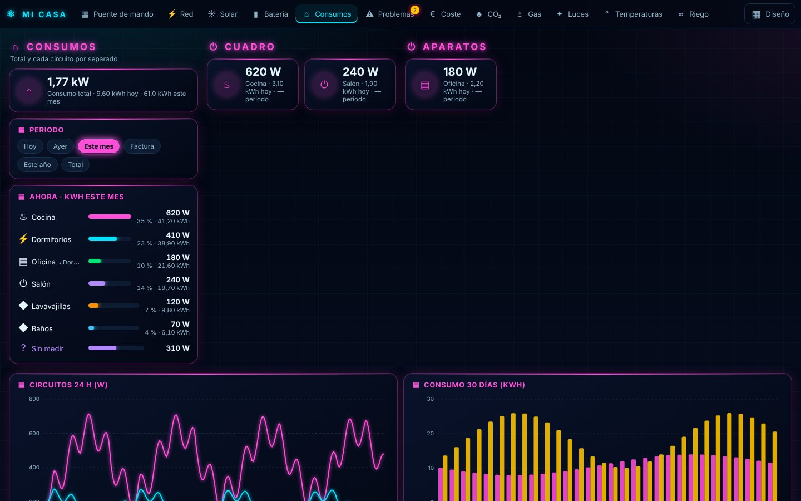
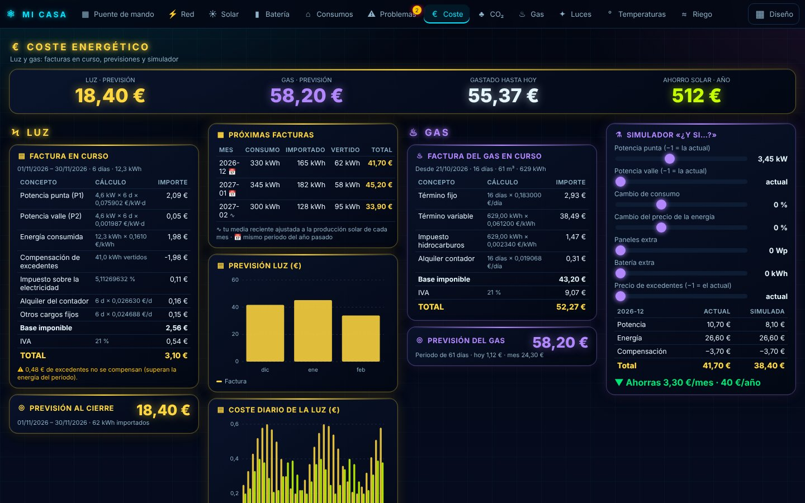
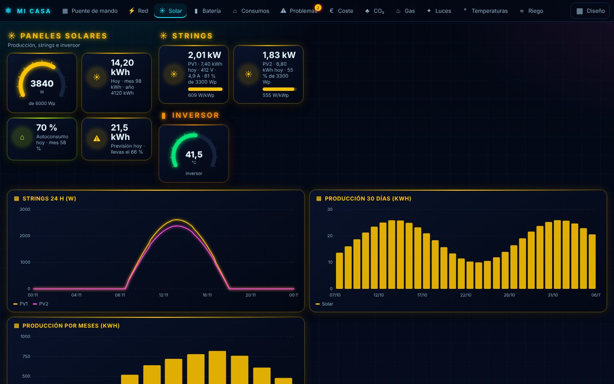
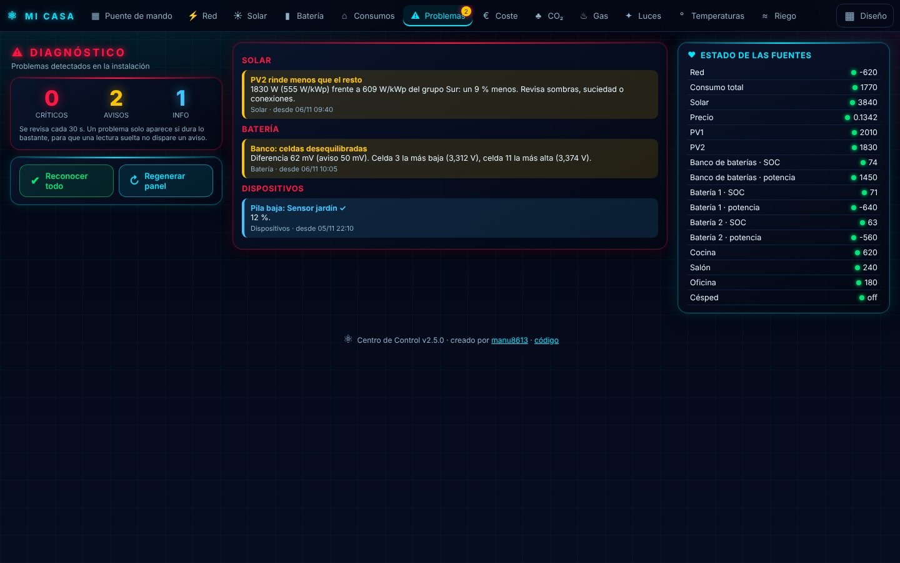
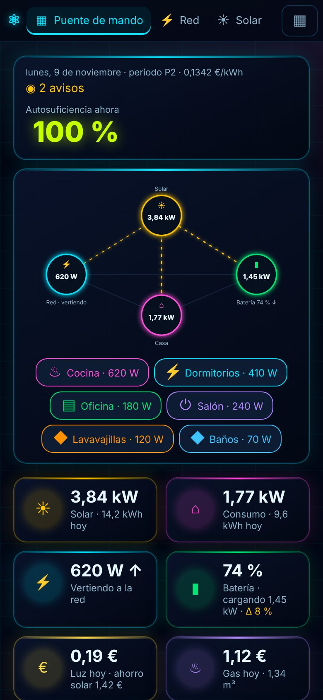
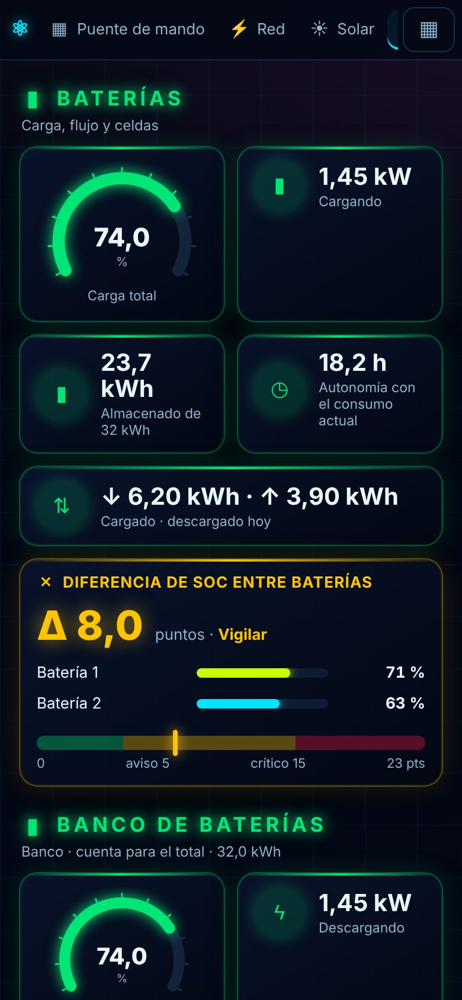

<p align="center"></p>

# Centro de Control

[](https://hacs.xyz/docs/faq/custom_repositories/)
[](https://github.com/manu8613/centro-control/actions/workflows/ci.yml)
[](https://github.com/manu8613/centro-control/releases)
[](LICENSE)

**Creado por [manu8613](https://github.com/manu8613).**

Un panel de control «sala de mando» para Home Assistant: energía de la red,
paneles solares, batería, cada consumo por separado, problemas detectados,
gas, luces, temperaturas, riego, coste de la luz con previsiones y CO₂
evitado. Se configura entero desde la interfaz y crea el panel solo.

> Pensado para instalaciones en España (peaje 2.0TD, PVPC, compensación de
> excedentes). La interfaz está en español.


## Capturas

Datos de ejemplo, no de ninguna casa real.

| Puente de mando | Batería |
|---|---|
|  |  |
| **Consumos** | **Coste de luz y gas** |
|  |  |
| **Solar** | **Problemas** |
|  |  |

<p align="center"> </p>

El botón **Diseño** permite mover y redimensionar secciones, tarjetas y
gráficas; cada dispositivo guarda su propio diseño.

## Las 13 pestañas

| Pestaña | Qué enseña |
|:--|:--|
| **Puente de mando** | Flujo de energía animado, indicadores clave, resumen del periodo elegido, alertas y gráfica de 24 h. |
| **Red** | Importación y vertido, uso de la potencia contratada, tensión y frecuencia, precio de hoy y mañana, 30 días. |
| **Solar** | Producción frente a la potencia pico, cada string (W, V, A, % de Wp), comparativa W/kWp, inversor, histórico diario y mensual. |
| **Batería** | Carga total, flujo, energía almacenada, autonomía, cada batería y sus celdas una a una, comunicación con cada BMS y diferencia de SOC entre baterías. |
| **Consumos** | Total, consumo sin medir, ranking de circuitos y aparatos, tarjetas por grupo y gráfica apilada. |
| **Problemas** | Críticos, avisos e información con el detalle de cada uno, estado de todas las fuentes e historial. |
| **Coste** | Luz y gas juntos: total previsto, factura en curso de cada uno línea a línea, previsiones, las tres siguientes facturas de luz y simulador «¿y si…?». |
| **CO₂** | CO₂ evitado, emitido por la red y el gas, huella neta, equivalencias en árboles y km, independencia energética. |
| **Gas** | Consumo y coste (detecta [Gas TUR](https://github.com/manu8613/gas-tur) automáticamente) y gráficas. |
| **Luces** | Encendidas, interior y exterior, sin conexión, control de cada luz y «Apagar todas». |
| **Temperaturas** | Media, máxima y mínima, mapa de calor, termostatos y gráficas de temperatura y humedad. |
| **Riego** | Cada zona con su tiempo, «Regar», humedad del suelo, lluvia, «Omitir si llueve» y «Parar todo». |
| **Configuración** | Cambio automático de pestañas (botón **Rotar**): tiempo en cada una, espera tras un toque y qué pestañas rotan; se guarda en cada dispositivo. |

### Interactivo

- **Selector de periodo** (hoy, ayer, mes, factura en curso, año, total): todas
  las cifras de energía y dinero cambian al momento.
- **Simulador**: mueve potencia contratada, consumo, precio, paneles o batería
  extra y ves al instante la próxima factura y el ahorro al año.
- **Riego temporizado**: elige los minutos con el deslizador y pulsa «Regar»;
  se cierra solo y nunca pasa del máximo de seguridad.
- **Luces** con brillo, **termostatos** con su temperatura y **botones** con
  confirmación para lo delicado.
- Tocar un indicador del resumen lleva a su pestaña; tocar cualquier valor abre
  su historial.
- Los problemas se pueden **reconocer**; los nuevos te avisan al móvil si
  quieres.

## Requisitos

- Home Assistant 2025.6 o posterior y [HACS](https://hacs.xyz).
- Nada más: el panel es propio (JavaScript incluido en la integración) y no
  depende de tarjetas de HACS ni del tema que uses.
- Opcional: la copia del panel en Lovelace (`config/centro_control/panel_<id>.yaml`)
  usa Mushroom, ApexCharts card, card-mod y Power Flow Card Plus.

## Instalación

1. HACS → ⋮ → **Repositorios personalizados** → añade
   `https://github.com/manu8613/centro-control` como **Integración**.
2. Instala **Centro de Control** y reinicia Home Assistant.
3. **Ajustes → Dispositivos y servicios → Añadir integración → Centro de
   Control**. Solo pide la potencia de la red (y, si los tienes, el consumo y la
   potencia solar).
4. Aparece **Centro de Control** en la barra lateral.

## Configuración

Todo se cambia desde la integración, sin YAML:

- **Configurar** abre un menú con una pantalla por área: general (día de la
  factura, avisos), red, consumo, solar e inversor, tarifa, gas, luces,
  temperaturas, riego, CO₂ y umbrales de problemas.
- **Añadir string**, **Añadir batería**, **Añadir circuito** y **Añadir zona de
  riego** suman cada elemento de tu casa. Puedes tener los que quieras y
  editarlos o borrarlos uno a uno.
  - Los strings del mismo **grupo** (misma orientación) se comparan entre sí.
  - Un circuito puede **colgar de otro** (por ejemplo, el frigorífico dentro de
    la línea de cocina): desactiva «Cuenta para el total» para no contarlo dos
    veces.
  - **Varias baterías detrás de un inversor**: crea una batería «banco» con el
    SOC y la potencia que da el inversor y una batería por cada BMS con
    «Cuenta para el banco» desactivado. El total sale del inversor; cada BMS
    muestra sus celdas, temperaturas, alarmas y comunicación, y el panel
    compara sus SOC (sensor «Diferencia de SOC entre baterías», con aviso y
    crítico configurables).
- Si no das un contador de energía, la integración integra la potencia. Si das
  uno (total o diario), usa sus lecturas y descarta saltos imposibles.
- Las luces, termostatos y sensores de temperatura y humedad se cogen todos
  automáticamente si no eliges ninguno (los de batería e inversor se excluyen).
- El panel se regenera solo al arrancar y con el botón **Regenerar panel**.
  Además se guarda una versión con tarjetas de Lovelace en
  `config/centro_control/panel_<id>.yaml` por si quieres copiarla a otro panel
  y retocarla.

## Entidades

| Entidad | Qué es |
|:--|:--|
| Potencia solar, de red, importada, vertida, de batería, consumo, sin medir | W en tiempo real. Red: + importa. Batería: + descarga. |
| Carga de la batería, energía almacenada, autonomía | SOC medio ponderado por capacidad, kWh y horas hasta la reserva. |
| Energía solar, importada, vertida, consumida, cargada y descargada | kWh de hoy (válidas para el panel de Energía). En los atributos: `hoy`, `ayer`, `mes`, `factura`, `ano`, `total`. |
| Coste de la energía, compensación, ahorro solar | € por periodo. |
| Factura en curso, previsión, factura simulada | Total en €; las líneas de la factura en los atributos. |
| Autoconsumo, autosuficiencia, CO₂ evitado y emitido, consumo de gas | Por periodo en los atributos. |
| Problemas, problema crítico | Número sin reconocer y la lista completa con nivel, área, detalle y desde cuándo. |
| Luces encendidas, temperatura y humedad interior | Resúmenes de la casa. |
| Periodo del panel, simulador, minutos de riego, regar, parar, reconocer, apagar luces | Los controles del panel. |

Cada string, circuito y zona de riego tiene además su propio dispositivo con su
energía o su tiempo restante.

Evento `centro_control_problema` al aparecer un problema nuevo, y acciones
`centro_control.regar`, `parar_riego`, `reconocer_problemas`, `crear_panel` y
`reiniciar_contadores`.

## Cómo calcula la factura

Como una factura real 2.0TD: potencia P1 y P2 × días, energía (por periodos
P1/P2/P3, desde un sensor como el PVPC o precio único), menos la compensación
de excedentes (con tope en la energía del periodo, desactivable), impuesto
sobre la electricidad, alquiler del contador, otros cargos fijos e IVA.

Valores por defecto (todos editables en **Configurar → Tarifa** y **CO₂**),
revisados el 6/11/2026:

- Potencia: peajes + cargos 2026 (P1 27,704413 y P2 0,725423 €/kW·año), sin
  margen de comercializadora.
- Impuesto sobre la electricidad 5,11269632 % e IVA 21 % (desde el 1/6/2026).
- Alquiler de contador 0,81 €/mes; financiación del bono social 9,011295 €/año.
- Red: 0,102 kg CO₂/kWh (mix nacional 2024, CNMC); gas: 0,182 kg CO₂/kWh
  (MITECO). Puedes usar un sensor de intensidad en vivo (p. ej. Electricity
  Maps).

La **previsión** suma lo gastado y la media de tus últimos 30 días para el
resto del periodo. Las **próximas facturas** usan el mismo periodo del año
anterior cuando ya hay histórico, y si no, tu media reciente ajustada a la
producción solar de cada mes.

## Problemas que detecta

Fuentes que no responden · strings sin producción o que rinden menos que los de
su grupo · celdas desequilibradas o fuera de rango · alarmas del BMS · BMS sin
comunicación · baterías con SOC muy distinto entre sí · batería
baja, caliente o cargando con frío · temperatura, fallo o alarma del inversor ·
tensión o frecuencia de red fuera de rango · cerca del límite de potencia ·
importar con la batería cargada · consumo sin medir o circuitos que suman más
que el total · pilas bajas de cualquier dispositivo · agua, humo, gas o
monóxido · riego abierto demasiado tiempo o con lluvia · tierra seca ·
temperaturas y humedad de la casa · gas consumiéndose sin parar.

Cada problema tiene que durar un tiempo antes de aparecer, para que una lectura
suelta no dispare un aviso.

## Configurar desde Windows con un token (opcional)

Para configurarlo todo de una vez, o hacer copias y restaurarlas, la carpeta
[`tools`](tools) trae `centro-control.ps1`. Pide la dirección de Home
Assistant y un token de larga duración de un administrador (Perfil →
Seguridad); el token no se guarda.

```powershell
powershell -ExecutionPolicy Bypass -File .\centro-control.ps1 exportar      # solo lee: inventario + configuración actual
powershell -ExecutionPolicy Bypass -File .\centro-control.ps1 aplicar .\plan.json
powershell -ExecutionPolicy Bypass -File .\centro-control.ps1 restaurar .\CentroControl\config_actual_<fecha>.json
powershell -ExecutionPolicy Bypass -File .\centro-control.ps1 comprobar
```

`aplicar` y `restaurar` hacen antes una **copia de seguridad completa** de
Home Assistant y guardan la configuración actual, simulan el cambio, piden
confirmación y al final comprueban que todo responde.

Usan una API solo para administradores:
`GET /api/centro_control/inventario`, `GET|POST /api/centro_control/configuracion`
y `GET /api/centro_control/estado`. El formato de `plan.json` es el mismo que
devuelve `GET /api/centro_control/configuracion`. Los elementos con el mismo
tipo y título se actualizan sin cambiar de identificador, así que sus
entidades y su histórico se conservan. Una entidad cuyo id aún no conoces se
puede indicar por su nombre: `"~sensor:BMS 1 SOC"` (o `"~BMS 1 SOC"`).

## Privacidad

- Todo se calcula dentro de tu Home Assistant; no se envía nada a ningún sitio.
- Este repositorio no contiene ninguna entidad, IP ni dato de ninguna casa. Lo
  que eliges en la configuración se guarda solo en tu instalación
  (`.storage/`). Una comprobación automática impide subir IPs privadas o
  claves al repositorio.

## Versiones y cómo volver atrás

- Cada versión se publica en [Releases](https://github.com/manu8613/centro-control/releases)
  con sus cambios en el [registro de cambios](CHANGELOG.md).
- **Volver a una versión anterior:** HACS → Centro de Control → ⋮ →
  **Volver a descargar** → elige la versión → reinicia Home Assistant. Tu
  configuración y tus contadores se conservan entre versiones con el mismo
  número mayor (por ejemplo, de 1.4.0 a 1.2.0).
- Las versiones `x.y.Z` solo corrigen fallos, las `x.Y.0` añaden cosas sin
  romper nada y las `X.0.0` pueden necesitar revisar la configuración.

## Desarrollo

```bash
pip install -r requirements_test.txt jinja2 pyyaml
pytest -q
python3 scripts/make_translations.py custom_components/centro_control/translations
```

Para publicar una versión: sube el número en `manifest.json` y `const.py` y
añade su apartado al `CHANGELOG.md`. Al llegar a `main`, GitHub pasa las
pruebas, crea la etiqueta `vX.Y.Z` y publica la versión sola.

## Autoría y licencia

**Centro de Control fue creado por [manu8613](https://github.com/manu8613).**

Se distribuye bajo la [Licencia Apache 2.0](LICENSE). Si copias, haces un fork
o redistribuyes este proyecto o una obra derivada, tienes que conservar el
fichero [NOTICE](NOTICE) y mencionar a **manu8613** como creador del proyecto
original, con un enlace a este repositorio.
